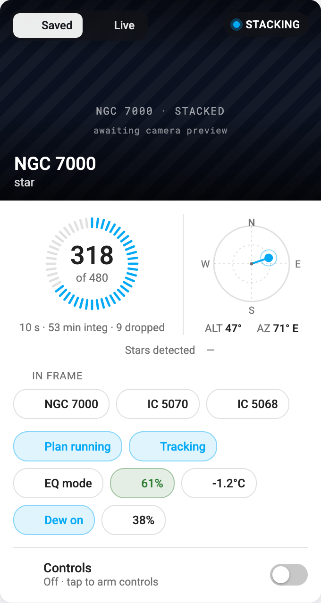
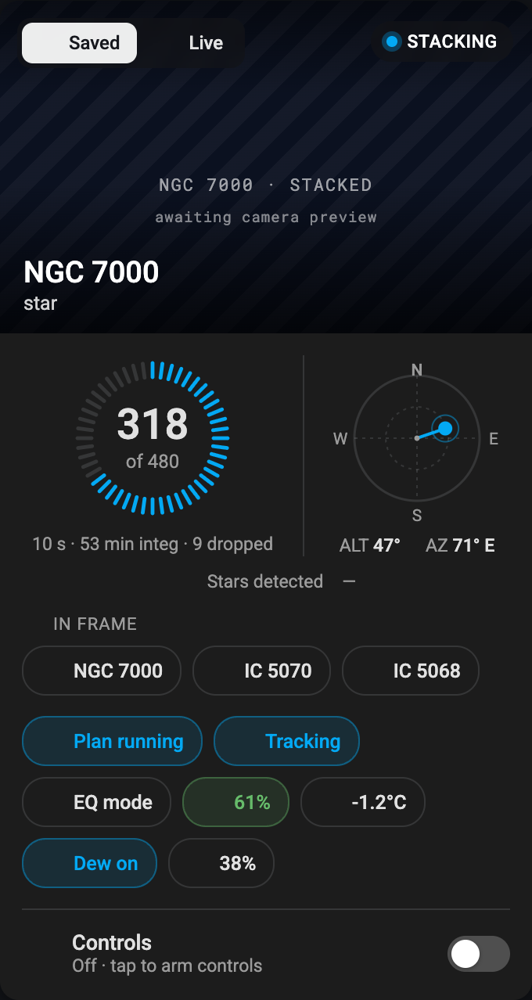

# Seestar Card

A custom [Home Assistant](https://www.home-assistant.io/) Lovelace card for
**ZWO Seestar** telescopes. It renders one scope's live imaging
state — the stacked-image preview, current target and mode, stacking progress,
plate-solved pointing, plan/mount status, and device health — as a single
self-theming card.

The card is a pure frontend consumer of the entities the
[`ha-seestar`](https://github.com/jaxzin/ha-seestar) bridge add-on publishes
over MQTT. It reads Home Assistant state only; it does not talk to the scope
directly.

> **Setting up the whole Seestar stack?** Start at
> [ha-seestar → Quick Start](https://github.com/jaxzin/ha-seestar#quick-start-home-assistant-os--supervised):
> it installs the driver and bridge add-ons, this card and the optional Seestar
> Sync archiver in one pass.

## Preview

<p align="center">
  
  
</p>

The card follows the active Home Assistant theme — light and dark shown above,
rendered against the demo's "stargazing" mock scope.

Want to poke at it before installing anything? The repo ships a standalone
fidelity demo. Run the [build](#development), then open
[`demo/index.html`](demo/index.html) in a browser — it mounts the real card
bundle against four mock scopes (stargazing, solar, scenery, and a
post-restart "all unknown" scope) in both light and dark themes, with no Home
Assistant required.

## Requirements

- **Home Assistant** with the Lovelace dashboard.
- The [`ha-seestar`](https://github.com/jaxzin/ha-seestar) bridge add-on,
  installed and **publishing entities** for your scope over MQTT. The card is a
  view over those entities — without the bridge it has nothing to render.
- A [ZWO Seestar](https://www.seestar.com/) on the same network, in
  station mode, per the bridge's setup.

> **Note on firmware ≥ 7.18:** the telemetry this card shows (target, stacking
> progress, battery, the stacked preview) rides the scope's event stream and
> needs no auth key. A handful of device-state fields and the control buttons
> require the challenge-response interop key described by the
> [`seestar_alp`](https://github.com/smart-underworld/seestar_alp) project — see
> the bridge docs. The card renders explicit "unknown" placeholders for any
> field that isn't available, so it degrades gracefully either way.

## Getting started

### Install via HACS (recommended)

[HACS](https://hacs.xyz/) handles resource registration and updates for you.

1. In HACS, open the **⋮** menu → **Custom repositories**.
2. Add this repository's URL with category **Dashboard**.
3. Find **Seestar Card** in HACS, install it, then reload your browser.

HACS registers the `dist/seestar-card.js` Lovelace resource automatically.

### Install manually

If you don't run HACS, install the bundle by hand (you'll need to repeat step 3
on every update):

1. Copy [`dist/seestar-card.js`](dist/seestar-card.js) into your Home Assistant
   `config/www/` directory. That folder is served at `/local/`, so the file
   lands at `/local/seestar-card.js`.
2. In **Settings → Dashboards → ⋮ → Resources**, add a resource:
   - **URL:** `/local/seestar-card.js?v=1` — the `?v=` query is a cache-buster;
     bump the number each time you replace the file so browsers reload it.
   - **Resource type:** **JavaScript Module**.
3. Reload your browser.

> Prefer the [HACS path](#install-via-hacs-recommended) if you can — it adds the
> resource and keeps the card up to date for you.

### Add the card

Add the card to a dashboard (Manual card / YAML mode):

```yaml
type: custom:seestar-card
device: seestar_s30_pro   # the bridge device-id prefix for your scope
```

`device` is the entity-id prefix the bridge assigns to the scope (a slug of the
scope's name). The card derives every entity id from it, e.g.
`camera.seestar_s30_pro_live_stacked_preview`,
`sensor.seestar_s30_pro_altitude`.

## Configuration

### Options

| Option              | Type                             | Default                                                                        | Description                                                                                              |
| ------------------- | -------------------------------- | ------------------------------------------------------------------------------ | -------------------------------------------------------------------------------------------------------- |
| `type`              | string                           | —                                                                              | Must be `custom:seestar-card`.                                                                            |
| `device`            | string                           | —                                                                              | **Required.** Entity-id prefix for the scope.                                                            |
| `name`              | string                           | the device prefix                                                              | Card title override.                                                                                     |
| `accent`            | string                           | `--primary-color`                                                              | Accent colour (any CSS colour).                                                                          |
| `camera_entity`     | string                           | `camera.<device>_live_stacked_preview`, falling back to `camera.<device>_live_preview` | Override the "Saved" hero camera entity. Set this if Home Assistant deduped yours to a `_2` suffix. |
| `live_camera_entity`| string                           | `camera.<device>_live_view`                                                    | Override the "Live" (`/vid`) hero camera entity.                                                        |
| `actions`           | map of key → `{service, data}`   | auto-wired to the bridge's control buttons                                     | Override scope-control service calls — see [Actions](#actions).                                          |

Example with overrides:

```yaml
type: custom:seestar-card
device: seestar_s30_pro
name: Backyard Seestar
accent: "#7c4dff"
camera_entity: camera.seestar_s30_pro_live_stacked_preview_2
```

### Actions

The card exposes a fixed set of scope controls behind the "Arm" switch. Each is
**auto-wired** to the bridge's canonical command button
(`button.<device>_<suffix>`) when that entity exists, so out of the box you
don't need to configure anything. Provide `actions.<key>` only to override the
default with a custom service call; unrecognised keys are ignored.

| Action key      | Default button entity            |
| --------------- | -------------------------------- |
| `stop_session`  | `button.<device>_stop`           |
| `pause_plan`    | `button.<device>_pause_plan`     |
| `goto`          | `button.<device>_goto`           |
| `park`          | `button.<device>_park`           |
| `start_session` | `button.<device>_start_live_view`|

An explicit override takes a `service` (`"domain.service"`) and optional `data`
payload:

```yaml
type: custom:seestar-card
device: seestar_s30_pro
actions:
  park:
    service: button.press
    data:
      entity_id: button.seestar_s30_pro_park
```

## Theming

The card is styled entirely with Home Assistant theme variables
(`--primary-color`, `--card-background-color`, `--primary-text-color`,
`--secondary-text-color`, `--divider-color`, `--secondary-background-color`,
`--success-color`, `--warning-color`, `--error-color`, `--ha-card-*`), so it
follows your active light/dark theme automatically.

## Development

```bash
npm ci
npm run lint    # tsc --noEmit (type-check)
npm run build   # bundle to dist/seestar-card.js
```

`dist/seestar-card.js` is committed so HACS can serve it directly. CI rebuilds
it and fails if the committed bundle drifts from `src/`, so **rebuild and commit
`dist/` whenever you change `src/`**. See [CONTRIBUTING.md](CONTRIBUTING.md) for
the full workflow and [CHANGELOG.md](CHANGELOG.md) for release history.

## License

MIT © 2026 Brian R. Jackson. See [LICENSE](LICENSE).
